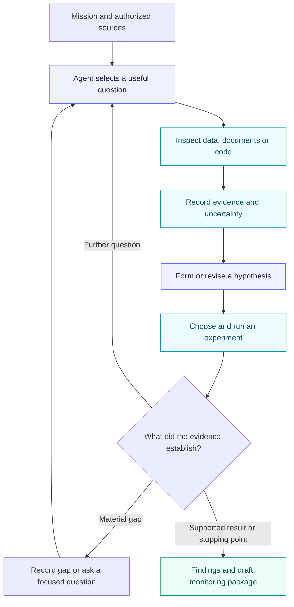

# Autonomous CyberArk Discovery and Workflow Design Agent

**Version 1.0 · 21 September 2026 · New design baseline**

## Product direction

Build a new autonomous investigation application from zero. Its mission is to understand CyberArk account data and its surrounding business context, discover quality problems, investigate their meaning, and produce the building blocks of an account quality workflow.

The starting inputs are a mission, available datasets, documentation, and optional account-model PoC source. Existing quality rules, precomputed findings, or a completed monitoring service are not prerequisites. Candidate checks and monitoring logic are products of investigation.

This replaces the earlier finding-first architecture as the product direction for this new build. Earlier documents can supply background or useful engineering ideas, but their fixed tool set, mandatory finding entry point, CPM-only scope, and existing-application reuse requirements do not govern this design. Keep the old implementation intact as a reference; create the new application in a new repository or clean project directory.

This document is a design and implementation brief. It does not claim that the application has already been built or that any organizational policy has been validated.

## The agent's mission

An initial mission could be:

> Understand the supplied CyberArk inventory and its relationships to account sources and business applications. Identify meaningful account quality issues and gaps in our knowledge. Investigate the strongest hypotheses, explain the evidence and exceptions, and produce a tested draft monitoring package for the checks supported by this investigation.

The operator defines the authorized data population, available sources, objective, and resource budget. The agent decides which questions to pursue, which tools to use, how to revise its hypotheses, and which outputs the evidence supports. It can proceed without an existing finding or an analyst selecting each next step.

Different missions can emphasize identity matching, suspected duplication, ownership, management reliability, or understanding unfamiliar source data. These are investigation topics, not a mandatory prewritten catalogue of checks.

Success is useful, supported discovery and reusable work products. Finishing a run is not a claim that every possible quality problem has been discovered.

## Inputs and outputs

| Inputs available at the start | Work products the agent develops |
|---|---|
| Account and safe metadata, users/groups, relationships, and recorded management history | A source inventory, field dictionary, and evidence-backed interpretation of relationships |
| AD/LDAP, database/local-account inventories, A2P references, and CMDB exports, where available | Candidate matching approaches, quality hypotheses, issue investigations, and collection gaps |
| IAM documentation, runbooks, approved policies, and specialist explanations | Explicit business interpretations, exceptions, unresolved questions, and policy references |
| Optional PoC source and model definitions | A documented account of implemented semantics and inconsistencies with observed data |
| Mission objective and authorized scope | Candidate monitoring checks, executable analysis, tests, reports, and a workflow proposal |

Each source is optional unless the particular investigation needs it. The agent must state which conclusions are blocked by unavailable or incomplete evidence. A source list is not a demand to implement every production connector before the first useful run.

The PoC is a research input. The new application does not inherit its architecture or automatically treat its field names and assumptions as business truth.

## Autonomous investigation loop



This diagram describes responsibilities and feedback, not a fixed sequence of business investigations. The agent may revisit a source definition, abandon an unsupported hypothesis, inspect a comparison cohort, or generate and test a proposed check as the evidence changes.

Maintain concise working state: current questions, hypotheses, supporting and conflicting evidence, experiments completed, open gaps, and the next proposed action. Record observable decisions and evidence references rather than hidden chain-of-thought.

The agent stops when the requested deliverables are sufficiently supported, a material gap prevents further progress, the operator stops it, or its budget is exhausted. Its final report distinguishes completed work, partial exploration, rejected hypotheses, and unexamined areas.

Open-ended planning with tool feedback is an established agent architecture. The particular discovery objectives and deliverables here are project-specific choices. See [Anthropic's agent architecture guidance](https://www.anthropic.com/engineering/building-effective-agents).

## Tool capabilities

Give the agent useful research operations that are independent of a finding ID:

| Capability | What it enables |
|---|---|
| Discover available sources and schemas | Understand datasets, fields, relationships, timestamps, and collection metadata |
| Inspect documentation and PoC source | Read relevant passages, model definitions, and mapping logic with document or revision references |
| Query and profile authorized data | Compute distributions, missingness, distinct values, joins, histories, and comparison cohorts |
| Execute generated analysis in an isolated workspace | Write and run bounded SQL or analysis code against approved snapshots to test a question |
| Retrieve detailed evidence | Inspect the records or source passages behind a summary without loading entire inventories into context |
| Create and evaluate artifacts | Produce candidate checks, tests, reports, and configuration in a draft workspace |
| Ask an operator question | Resolve a specific domain ambiguity while continuing independent work where possible |

SQL, statistics, joins, and validation code are instruments the agent can use during research. They do not impose a pre-existing quality rule engine or decide which business questions the agent is allowed to ask.

Generated analysis executes against isolated, authorized copies with resource limits and no production credentials. Constrain filesystem and network access, disable unnecessary database extension or external-access capabilities, and capture execution results. Runtime inputs must not be able to change these execution boundaries. Draft artifacts are writable inside the task workspace; production source systems remain unchanged.

Start with one source-ingestion route using metadata-only exports and a working analysis environment. Add connectors when real missions need them. Never send account secrets or source credentials to the model.

## Evidence and domain understanding

Every material observation should retain its source or snapshot, query/analysis reference, observed result, and relevant coverage limitations. A generated query is a proposed experiment until it runs successfully; its explanation is not evidence of execution.

Use explicit distinctions among:

- **Observation:** what a source or executed analysis actually showed.
- **Hypothesis:** a possible explanation or relationship that still needs testing.
- **Domain requirement:** an intended behavior supported by an applicable policy or specialist decision.
- **Candidate check:** a proposed operational test, including its assumptions and exceptions.
- **Unknown:** something the available evidence cannot establish.

Test promising hypotheses against alternative explanations, counterexamples, and additional cohorts. Where possible, evaluate proposed logic on data not used to formulate it. Preserve rejected ideas so the agent does not repeatedly rediscover the same dead end.

Patterns alone cannot establish intended policy. For example, a dominant safe-to-application relationship may suggest an ownership mapping, but does not prove that shared ownership is forbidden. The agent should package that question for the IAM specialist rather than manufacture a requirement.

Sampling supports exploration. Reports must identify the sampled population and distinguish sample results from full-scope measurements. Missing or stale inventories remain limitations on any claim about account existence.

## Context, memory, instructions, and skills

Build these capabilities into the new runtime with simple interfaces:

- **Context assembly:** give the model the mission, relevant source definitions, current questions, selected evidence, active skill, and remaining budget. Retrieve additional detail when needed. Preserve contradictions, exceptions, and material gaps when reducing context.
- **Durable mission state:** checkpoint plans, evidence references, hypotheses, experiments, artifacts, usage, and stop reasons. Resume with the same pinned source observations and applicable configuration, while rechecking access.
- **Memory:** separate current mission state, dated case evidence, and reviewed reusable knowledge. Historical lessons can guide a search; they cannot establish current facts or silently become policy.
- **Runtime `AGENTS.md`:** explicitly load common investigation guidance from a configured runtime asset. Keep developer build instructions separate. Record the applied version and include it in context accounting.
- **Agent Skills:** discover approved skill metadata, load relevant `SKILL.md` procedures on demand, and allow the agent to switch procedures as its investigation develops. Suitable procedures include source reconnaissance, relationship investigation, hypothesis testing, monitoring-check authoring, and report preparation.
- **Feedback and evolution:** let the agent generate draft improvements to checks, prompts, or skills, with experiments and supporting feedback. Publish new runtime versions through the existing project review process; generated text does not grant itself new permissions.

Use one agent runtime initially. Model-selected tool calls and later actions must be able to depend on earlier results. A fixed list of profiling steps followed by an LLM summary does not satisfy this requirement.

Track one mission-wide resource budget across tool use, code execution, model calls, retries, and sub-investigations. Choose initial limits through pilot measurements. Do not reset the budget simply because the agent creates a new question or case.

## Deliverable: a draft monitoring package

The agent should produce work products that an engineer and IAM specialist can inspect and develop into the operational workflow:

| Artifact | Required content |
|---|---|
| Investigation report | Questions pursued, evidence, supported findings, rejected hypotheses, uncertainty, and unexamined scope |
| Source and relationship notes | Field meanings, candidate identities and mappings, provenance, ambiguity, and source limitations |
| Check definitions | Purpose, applicability, supporting evidence or policy, assumptions, exceptions, severity rationale, and expected output |
| Executable checks | SQL or code that runs on the supported data contract, with a reproducible invocation |
| Evaluation cases | Positive, negative, exception, missing-data, and counterexample cases; held-out data where available |
| Workflow proposal | Required inputs, collection dependencies, suggested cadence, reporting, review needs, and how candidate findings become work items |
| Handoff | What was verified, what remains a proposal, missing decisions, and the next implementation tasks |

Some investigations will yield useful unresolved questions without a justified executable check. That is an acceptable outcome when supported by the evidence. Do not fabricate checks to fill an artifact quota.

A successful candidate check can be run automatically on future snapshots after its semantics and behavior have been reviewed. This operational monitoring service is a downstream product of discovery. The first agent does not require that service to exist before it can investigate.

## Worked example

The mission is to understand account management reliability. No findings are supplied.

The agent inspects the available inventory, event history, field definitions, and source coverage. It notices that a current status field may conceal prior failures and asks whether some cohorts repeatedly fail before eventually succeeding.

It writes and executes an analysis of operation histories, checks event ordering and operation semantics, compares relevant cohorts and periods, and tests whether changing collection coverage or activity explains the apparent pattern. If the inputs are insufficient, it records that limitation instead of assuming a rate or cause.

If the pattern remains supported, the agent prepares a finding with evidence and a candidate recurring check. It includes the executable analysis, the required source fields, known exceptions, tests, and a report example. Any threshold that requires an operational judgment is clearly marked for a specialist decision.

The investigation has produced monitoring logic. There was no prerequisite rule that had to flag the accounts first.

## First-build scope and evaluation

Build a standalone application with a mission interface, source inspection, an isolated analysis workspace, one adaptive model/tool loop, durable state, runtime instructions/skills, and artifact generation. A CLI and Markdown/JSON outputs are sufficient initially. Keep framework and infrastructure choices modest so the first end-to-end investigation is easy to inspect.

The first pilot uses a bounded but representative data bundle and an actual domain question. The sample can be narrow for practicality without encoding that subject as the only investigation the architecture can support.

Demonstrate these behaviors:

1. A mission can start with datasets and documentation, without any rule results or finding IDs.
2. Different evidence causes different subsequent tool choices; unsupported hypotheses can be rejected.
3. The agent executes analysis and preserves results rather than inventing observations.
4. It can encounter ambiguity, ask a focused question, and continue other useful work.
5. It produces an executable candidate check and meaningful validation artifacts when the evidence warrants one.
6. It can also finish with an explicit unresolved gap instead of forcing a rule or conclusion.
7. A mission resumes consistently, respects its scope and budget, and identifies what it did not examine.
8. Runtime instructions and skills are actually loaded and reflected in captured model requests.

Use realistic reviewed or synthetic cases containing both ordinary data and issues not disclosed as precomputed findings. Keep evaluation reference answers separate from the inputs used during the investigation. Measure supported discoveries, incorrect claims, missed known issues, useful check candidates, artifact reproducibility, specialist review effort, and runtime cost.

Mock runs establish integration behavior. Live model runs and specialist assessment establish evidence about investigation quality. Do not claim autonomous discovery from a scripted demo whose tool path and answer were predetermined.

## Prompt to begin the new Copilot build

```text
Read docs/agent_design.md and build a new standalone application around this design.

This is a fresh product direction. The application starts from an investigation mission, authorized datasets, documentation, and optional PoC source. Candidate quality checks and monitoring logic are outputs. Do not require a deterministic rule engine, an existing finding, a finding ID, or the earlier investigation application to start a mission.

Follow applicable repository instructions and inspect any existing files before editing. Use the previous PoC only as optional research material. Identify meaningful conflicts with older design documents; use this document for the new product scope.

First establish a small end-to-end slice: ingest a synthetic metadata bundle, accept a mission, let the model choose and revise evidence-gathering actions, execute analysis in an isolated workspace, retain evidence and uncertainty, and produce a report plus a tested candidate monitoring check when supported.

Include runtime context/state management and explicit AGENTS.md and SKILL.md loading. Demonstrate that tool selection depends on previous results. Preserve source access boundaries and distinguish mock demonstrations from live-model evaluation.

Give a concise implementation plan, then implement the first working slice with meaningful behavioral checks. Keep unfinished capabilities explicit. Update docs/agent-handoff.md with actual code references, commands/results, limitations, and the next bounded task. Do not substitute a fixed profiling script followed by an AI summary for the autonomous investigation loop.
```
