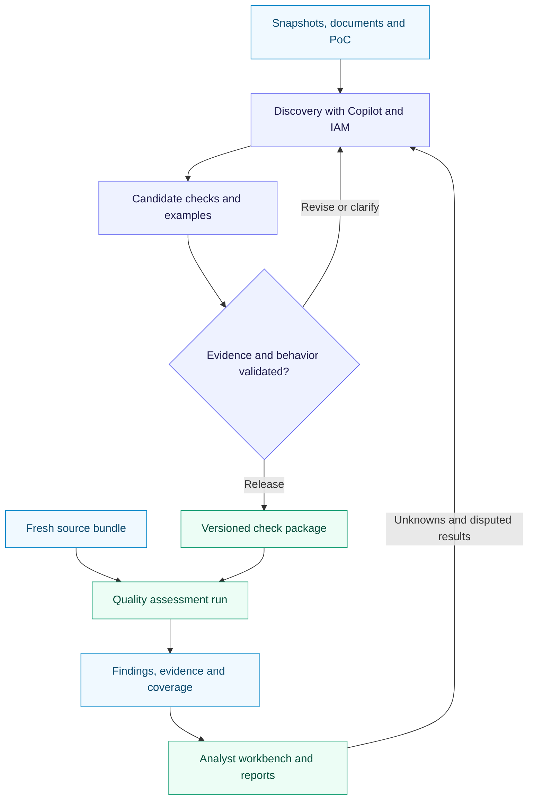

# CyberArk Account Quality System — Design and Implementation

**Version 2.0 · 13 October 2026**  
**Direction confirmed:** use Copilot directly for investigation and engineering; build the account-quality application that results from that work.  
**Status:** implementation brief. Actual repository, data contracts, unsuccessful runs, and acceptance examples still require inspection.

This document replaces the earlier autonomous-agent and Codex-style frontend briefs as the product direction for new work. It preserves useful domain knowledge and allows reuse of working implementation components. It does not instruct Copilot to delete the existing application, overwrite local changes, or disregard applicable repository and access instructions.

The author reviewed the previous design briefs and the requirements represented by the five uploaded CyberArk screenshots. The user reports that both investigation quality and the overall product fell short. The author has not inspected the implemented repository, model requests, execution traces, or actual outputs. Consequently, the design observations below are not a diagnosis of the implementation.

## 1. Decision and rationale

Build a focused account-quality application with repeatable analysis, inspectable evidence, review decisions, and recurring reports. Use the established Copilot environment to explore unfamiliar data, investigate difficult cases, propose checks, and implement improvements.

The original ambition remains: AI helps discover useful logic from data, documentation, existing code, and IAM expertise. The location of that investigation changes. We use Copilot's existing development environment instead of first building a separate investigation platform that must manage its own tools, planning, context, memory, skills, and conversation interface.

Checks remain outputs of discovery. We do not require a complete catalogue of business rules before useful investigation starts. Once a particular check is justified and tested, the application can run it repeatedly on fresh data without asking an LLM to rediscover its meaning each time.

| Approach | Decision for this project | Reason |
|---|---|---|
| Copilot investigates accessible exports, documentation, and code, then develops the quality application | Adopt now | Concentrates work on domain understanding and usable business outputs |
| Continue expanding our custom general investigation runtime | Suspend as the main investment | Its benefit has not been demonstrated by the user's experience |
| Embed a supported agent runtime inside the product | Reconsider only for a demonstrated requirement | Appropriate if analysts later need interactive investigation inside the application; still requires tool, data, and quality evaluation |

This is not a claim that Copilot necessarily outperforms every specialized agent. Domain tools and good evidence can make a specialized application effective. The practical issue is where this project should spend its next effort.

The earlier briefs described many engineering capabilities before establishing that the application solved a representative analyst task well. Streaming, memory, skills, and an attractive chat interface can all work while business results remain disappointing. The new unit of delivery is one analyst task completed with verifiable evidence.

### What must be checked in the existing implementation

| Possible contributor | Evidence needed before drawing a conclusion |
|---|---|
| The product optimized for conversations instead of useful work | One expected-versus-actual analyst journey, with the output the analyst needed |
| The model lacked usable data or executable tools | Source availability, actual tool inputs/results, truncation, execution errors, and source coverage |
| The instructions or field meanings were wrong | Applied instructions, field mappings, policy assumptions, and a specialist's counterexample |
| The chosen model or runtime behaved poorly | A reproducible task, model/configuration, observed actions, and results with the same available evidence |
| A scripted demo or narrow fixtures concealed shortcomings | Live-run artifacts and evaluation examples that were not used to shape the implementation |

Keep these as hypotheses until the evidence exists. Do not attribute all failures to the model or to Copilot-generated code.

## 2. Product outcome and scope

An IAM analyst should be able to answer: **Which accounts need attention, what evidence supports that assessment, what changed, and what should we investigate or review next?**

The first operational release reads metadata and recorded history. It supports monitoring, investigation handoff, review, and reporting. Production cleanup is a later capability with its own execution design.

| Original business request | Useful application result | Boundary of that result |
|---|---|---|
| Accounts that match uniquely but fail CPM management | A filterable account list with identity evidence, source-defined management observations, and timestamps | A failure observation alone does not establish its cause |
| Accounts that look duplicated | Candidate groups with scoped identity evidence, safe membership, and known consumers | Multiple records do not establish which record can be removed |
| Corrections for `AA_RetrieveOnly` | A work queue showing supported classifications, alternatives, and missing discriminators | No forced platform assignment from a name or label |
| Remove known dead accounts | A lifecycle review queue identifying corroborating and conflicting observations | No deletion operation in the first release |
| Reenable CPM where required | Configuration deviations evaluated against applicable policy and recorded exceptions | No automatic enablement or password operation |
| Identify which business application should own a safe | Ranked or grouped supported ownership candidates, relationship paths, and unresolved mixed-use cases | Ownership inference does not grant access or mandate moving accounts |

These are discovery topics and eventual product capabilities. Select the first implementation topic using actual source coverage and an analyst's useful example; do not implement all six superficially.

## 3. Responsibilities and architecture

| Participant or component | Responsibility |
|---|---|
| IAM specialist and product owner | Explain intended behavior, supply exceptions and representative cases, assess usefulness |
| Copilot in the approved development environment | Inspect code/data, perform exploratory analysis, develop candidate checks and tests, implement and debug features |
| ChatGPT design collaboration | Challenge assumptions and refine the design using supplied evidence; it has no implicit access to company data |
| Quality application | Import observations, execute released checks, preserve evidence/history, support review, and produce reports |
| Existing project review process | Accept semantic changes and release tested code/configuration |

The two connected activities are discovery and operation:



Ordinary scheduled assessments do not depend on an LLM session. New questions and disputed cases feed back into discovery. AI-generated changes enter the codebase as reviewable, tested changes through the normal release process.

## 4. How AI is used directly

### 4.1 Create a usable investigation workspace

Give Copilot access, within the approved environment, to the relevant repository, metadata-only source bundle, source dictionary, runbooks, policy references, and optional PoC. Start with local exports if production connectors are unavailable. A coding agent can only investigate data that its selected environment and tools can actually access; a cloud session does not automatically reach company network sources.

Prepare these persistent project records:

| Record | Contents |
|---|---|
| `docs/domain/source-contracts.md` | Actual fields, meanings, scopes, timestamps, coverage, and mapping decisions |
| `docs/domain/decisions.md` | Intended behavior, source/owner/date, applicability, exceptions, unresolved questions |
| `docs/discovery/` | Focused investigations with source IDs, executable analysis, results, counterexamples, and proposed checks |
| `checks/` and the existing test location | Released check implementations, metadata, fixtures, and invocation instructions |
| `docs/implementation-handoff.md` | Current implementation, observed test results, data gaps, and next bounded task |

Real datasets can live outside the repository in an authorized path. Reference them through a manifest. Commit only permitted fixtures and metadata. Pseudonymization must preserve joins and distinguish identities; document when it changes naming patterns relevant to an investigation.

### 4.2 Run a discovery session

For each meaningful question, Copilot should:

1. State the question and required evidence. Inspect actual schemas and coverage before proposing conclusions.
2. Profile relevant fields and relationships. Compare existing PoC behavior with documentation and observed data.
3. Generate and execute useful SQL or analysis code on the authorized snapshots. Keep commands, parameters, snapshot references, results, and limitations.
4. Test alternative explanations and exceptions. Separate an observed pattern from an organizational requirement.
5. Ask a focused domain question when the intended behavior cannot be inferred from evidence. Continue independent useful work where possible.
6. Produce a small discovery record and, when justified, a candidate check with applicability, exceptions, expected outcomes, and tests.

“All accounts should be CPM-enabled” and “an absent match means the account is dead” must not enter the system merely because they appear plausible or common. Applicable policy or stronger evidence is required.

Copilot may explore without a pre-existing finding, and it may conclude that a useful check cannot yet be supported. The output can be a collection requirement, corrected field interpretation, or explicit unresolved question.

### 4.3 Use existing agent capabilities where available

Use the installed Copilot environment's supported repository instructions and skills to make recurring discovery procedures convenient. Confirm support in that environment instead of implementing another custom `AGENTS.md` or `SKILL.md` loader inside the quality application. Keep important domain decisions and executable work in repository files so continuity does not depend on an agent remembering an earlier chat.

Start with normal file, terminal, and test access. Add MCP connections only when a required approved source cannot be served conveniently through the existing workflow. Model selection, context settings, and tool availability should be recorded for difficult investigations, but a framework migration is not the default response to a bad answer.

### 4.4 Evaluate AI's contribution

Assess whether direct AI-assisted work produces a correct explanation or useful check faster than the current manual process. Measure analyst effort, unsupported conclusions, accepted/rejected candidates, and reproducibility. For a comparison with the existing custom agent, use the same accessible evidence and task, report differences in tool access, and retain unsuccessful cases.

Use specialist-authored or reviewed reference cases. Keep a small separate evaluation set to detect overfitting to discovery examples; an AI inventing both a rule and its only expected answers does not establish domain correctness.

## 5. Source contracts and account semantics

### 5.1 Snapshot contract

Each source snapshot needs a source-system instance, snapshot ID, extraction interval, declared scope, collection status, raw file hashes, row counts, field-mapping version, and known omissions. Record pagination and permission coverage where the collector can establish them. Distinguish `complete`, `partial`, and `unknown` coverage for the declared population; an uploaded file is not automatically complete.

A run pins an immutable bundle of source snapshots and the versions of mappings, policies, and checks. Sources may have different collection times. Define per-check acceptable age and cross-source time skew through pilot/domain decisions. Unsupported freshness assumptions remain explicit configuration gaps.

Accept one documented export format per selected source initially. Reject or quarantine malformed rows with counts and reasons. Preserve valid raw values alongside derived values; do not silently “clean” identifiers while importing. Empty inputs, absent columns, explicit nulls, and failed collections are distinct conditions.

Use metadata field allowlists. Credentials, passwords, keys, tokens, and raw secret payloads must not enter the analysis store, reports, or model context. Sanitize diagnostic text before sharing it outside its authorized environment.

### 5.2 Canonical observations

The following are internal application concepts, not assertions about exact CyberArk API field names:

| Entity | Minimum information |
|---|---|
| Account observation | Source instance, scoped record ID, snapshot, safe reference, raw username/address/platform properties, classified family and its basis |
| Identity observation | Directory/host/database identity scope, source identity ID where available, raw identifiers, lifecycle observations, snapshot |
| Management observation | Account reference, enablement value, disable reason, status/operation, event or observation times, source-defined error information |
| Relationship observation | Typed source/target references, relation type, source provenance, observation time, validity/coverage limits |
| Match result | Compared references, method/version, candidate set, accepted match or unresolved state, evidence |
| Assessment | Check/version, run, subject, result, reason, evidence references, applicability and coverage |
| Finding and review | Stable subject/check lineage, observations over runs, triage decisions, exceptions, and review history |

An account record stored in CyberArk and its underlying managed identity are separate entities. Do not collapse them into one primary key. The same underlying identity may have more than one Vault record.

### 5.3 Domain rules for interpretation

| Area | Required behavior |
|---|---|
| AD matching | Use identity scope and validated mappings. Stable directory IDs are useful when available on both sides or through a verified mapping; username alone is insufficient. |
| Local accounts | Preserve host identity and lifecycle. An unreachable or retired CMDB asset is not by itself proof that a target account is absent. |
| Database accounts | Resolve engine/instance/database/principal scope as applicable. Host plus port is an endpoint clue, not a universal account identity. |
| Case and aliases | Apply source/platform-specific semantics. Preserve raw values and approved aliases; do not lowercase every username or accept fuzzy names as identity proof. |
| LDAP | Establish whether `userDn` means the managed principal or a bind identity. Distinguish DN, CN, and endpoint/URL. Use directory-aware comparison; RFC 4514 does not define a universal canonical DN string. |
| Platform labels | Treat platform as a declared configuration to validate. `AA_WinDomDefault` is an environment-specific hint; `AA_RetrieveOnly` does not determine identity family. |
| A2P | Confirm the actual reference field and match the exact account ID in the appropriate Vault/source scope. Activity semantics must come from its source contract. |
| Management state | Keep management enablement, operation/status observations, verification times, and identity existence separate. A success observation cannot prove unique matching, absence of duplicates, or indefinite current health. |
| Duplicate candidates | Show multiple records for a supported identity, their safes, management settings, and known consumers. Intentional duplication remains possible. |
| Safe ownership | Follow accepted account/asset/application-instance/business-application paths and show conflicts. Names are supporting hints. Shared infrastructure and mixed-use safes need explicit treatment. |

The screenshot's `cpmStatus`, `cpmEnabled`, and `cpmErrorReason` may be local aliases. Validate their actual mapping. CyberArk's documented account response separates automatic-management enablement, management status, and verification/reconciliation timestamps [R3]. Do not invent a timestamp for a status that has none.

Matching returns explicit states such as `UNIQUE_MATCH`, `AMBIGUOUS`, `NO_MATCH_OBSERVED`, `CONFLICT`, and `UNASSESSED`. Every state carries coverage and provenance. `NO_MATCH_OBSERVED` never silently becomes “dead account.”

## 6. Application structure

Use one deployable application with clear internal modules and a separately invocable assessment job. Reuse a sound existing backend, database, and frontend. The repository audit should decide which components already satisfy these responsibilities.

| Module | Responsibilities |
|---|---|
| Source ingestion | Import/collect, validate mappings, record provenance and coverage, construct immutable bundles |
| Domain analysis | Scoped identities, relationship traversal, and shared analysis needed by actual released checks |
| Assessment runner | Execute a pinned check package on a pinned bundle and persist outcomes/evidence |
| Findings and review | Track observations, assign review state, record scoped exceptions and decisions |
| Reporting | Compute counts, supported comparisons, exports, and investigation handoff bundles |
| HTTP API and workbench | Expose analyst operations and evidence using the application's access model |

Avoid building a general workflow language or extensible agent platform as part of this release. Add shared domain abstractions after more than one implemented check needs them.

If no reusable stack exists, a reasonable pilot default is Python for analysis, a small HTTP backend, and the existing web framework if available. Select one analytics store suited to the input size and one authoritative location for run/review metadata; prefer the current database if it serves both adequately. Record actual dependency choices, versions, run commands, and concurrency limits in an architecture decision. Framework selection must not consume the first business milestone.

An assessment can initially be a CLI/background job with persisted progress and polling. Long-running HTTP request lifetimes must not determine job lifetimes. Reuse existing streaming only if it already works and is useful.

## 7. Check packages and result contracts

A check package is ordinary reviewed project code or SQL with a small metadata definition. Copilot can develop it during discovery. The production application executes released packages; an uploaded dataset or model response cannot introduce executable checks into an operational run.

Each check defines:

- ID, version, semantic lineage, purpose, and subject type: account, candidate group, safe, or source.
- Applicable population and required mappings/sources, including freshness and completeness conditions.
- Exact meaning of a flagged result: observed condition, suspected issue, or policy deviation.
- Implementation reference, parameters, exception behavior, evidence fields, and expected output.
- Supporting discovery/policy references and positive, negative, ambiguous, and missing-data tests.

An illustrative metadata shape is:

```yaml
id: management.failure_for_unique_identity
version: 1.0.0
subject_type: account
meaning: observed_condition
title: Recorded management failure for a uniquely matched account
required_sources:
  - cyberark_metadata
  - applicable_identity_inventory
required_semantics:
  - validated_management_status_mapping
  - scoped_unique_identity_match
implementation: checks.management_failure.evaluate
evidence_fields:
  - account_reference
  - match_reference
  - management_observation_reference
  - snapshot_references
```

This is a candidate example from the source requirements, not a pre-approved organizational check. Its name, implementation path, and version are proposed. The discovered source contract determines the full predicate, applicable operation semantics, and freshness configuration.

### Outcome semantics

| Result | Meaning |
|---|---|
| `PASS` | The particular checked condition is absent, with sufficient applicable evidence |
| `FAIL` | The check's defined condition is present; its meaning may be a candidate issue rather than a policy breach |
| `UNKNOWN` | Evidence, semantics, freshness, or execution is insufficient to decide |
| `NOT_APPLICABLE` | Evidence establishes that the subject falls outside this check's applicability |

For the illustrative failure check: a supported unique match plus a sufficiently current, mapped failure observation is `FAIL`. A supported unique match plus a usable observation that does not meet the failure condition can be `PASS`. An ambiguous identity or uninterpretable status is `UNKNOWN`. A family explicitly excluded by the check is `NOT_APPLICABLE`. A management exception is shown separately and does not rewrite the recorded observation.

Return a reason code and evidence references for every outcome. An execution exception becomes a visible execution error and an unknown assessment for affected subjects where they can be enumerated. If the eligible population itself cannot be enumerated, mark the affected scope/run incomplete rather than pretending to produce complete per-account results.

The runner should accept a bundle ID, released check-package version, scope, and explicit parameters. It emits a run manifest, assessment rows, evidence records, and completion/coverage information. Same pinned inputs and code must yield equivalent ordered results after excluding generated IDs/times. Missing checks, unsupported mappings, and skipped partitions must be reported.

## 8. Evidence, review, and history

Evidence links must resolve to a retained source observation or executed analysis. Store source/snapshot IDs, scoped record references, query/code version or hash, parameters, bounded supporting results, execution status/time, and coverage limitations. A stored query without a successful execution result is not an observation.

Keep assessment outcome separate from analyst workflow state. Suggested review states are `unreviewed`, `investigating`, `confirmed`, `expected_condition`, and `needs_information`. An analyst confirming or dismissing a finding does not change the underlying observation.

Exceptions have a scoped subject or population, applicable check/policy, reason, owner/reviewer, effective period, and supporting reference. Retain history, show expired exceptions, and apply them only within scope. Updating an exception must not rewrite past reports.

Stable finding identity uses check lineage and a stable scoped subject key. Snapshot IDs identify observations, not a new finding each day. Use a supported canonical identity for a duplicate group when available; changes to an unresolved group's membership require explicit lineage/supersession rather than an invented stable identity.

Finding comparison distinguishes new, persistent, reopened, resolved, and not-comparable observations. A fresh comparable `PASS` may resolve the assessed condition. A disappearing row, lost source access, changed check meaning, changed scope, or `UNKNOWN` result cannot establish resolution. Preserve the last known finding and display why current reassessment is unavailable. Explicit confirmed retirement/removal observations can be reported separately without claiming that disappearance itself proved remediation.

Each report states its check versions, scope, bundle, and denominators. Count affected accounts separately from findings. If a rate excludes unknown or not-applicable assessments, show those counts alongside the rate. Compare the same subject population and compatible semantics; show coverage and policy changes separately from account-state improvement.

## 9. Analyst workbench

Organize the interface around an assessment run and the analyst's next useful action. Reuse the existing application's components, theme, routing, tables, and evidence/artifact panels where they work. A Codex-style conversation is no longer the required home screen.

| View | Essential behavior |
|---|---|
| Sources and runs | Show available bundles, declared scope, collection times, omissions, run status, check versions, and a supported Run action |
| Account-quality results | Search/filter by account, safe, family, check, result, source coverage, and review state; retain filters in the URL |
| Account or finding detail | Show raw/mapped attributes, identity candidates, management observations, evidence, relationships, previous assessments, and review controls |
| Comparison and report | Show new/persistent/resolved/unknown changes only where comparable; explain excluded scope and export the same underlying results |
| Investigation handoff | Assemble a selected case, relevant evidence, mappings, policy references, and unresolved questions for direct work in Copilot |

The default quality view shows usable data immediately: source/run selection, coverage, a filterable work queue, and a detail inspector. Show concrete counts tied to the selected run. Do not start with a large composite “health score” whose weighting and denominator have not been agreed.

For each finding, the analyst should be able to understand why it appeared, follow its evidence, identify what is unknown, record a disposition or request more evidence, and export the case. Reports should preserve the selected scope and filters; exports must not silently widen access or omit pagination.

An investigation handoff is an actual downloadable package or a copyable prompt referencing accessible files. Include the run/check versions and bounded evidence. The operator then opens it in an authorized Copilot workspace. The product must not claim it launched Copilot or completed an investigation unless a supported integration actually did so.

Keep synthetic demo data explicitly labeled. A failed live request must remain a failed request. UI verification should cover empty, loading, partial, failed, unknown, and permission-denied states as well as the successful journey. Preserve keyboard access, readable tables, and a useful detail layout at supported screen sizes.

## 10. Service contracts and operational behavior

Adapt route names to the actual framework. The following describes required operations, not a requirement to replace existing working APIs:

| Operation | Inputs and essential response |
|---|---|
| Import a source bundle | Manifest/files; returns ingestion status, validation errors, coverage, and immutable bundle references |
| Start an assessment | Bundle, released check package, scope, parameters, idempotency key; returns run ID |
| Read run state/results | Run ID plus paginated filters; returns status, coverage, assessments, and counters from persisted data |
| Read evidence | Evidence ID within an authorized run/subject; returns provenance and retained supporting observations |
| Record review or exception | Subject/assessment reference, decision, reason, expected current version; returns saved revision |
| Compare runs | Two run IDs and requested scope; returns comparable outcomes and explicit reasons for exclusions |
| Export report or case | Run/subject/filter references; returns an authorized artifact and export manifest |

Use persisted run states such as `queued`, `running`, `completed`, `partial`, `failed`, and `cancelled`. Do not treat a dropped browser connection as job completion or cancellation. If cancellation is exposed, it must stop work at a supported boundary and record partial coverage accurately.

Persist assessment results in a way that supports safe retry. A duplicate start request with the same idempotency key must not launch a second job. Publish a completed run only after its result/evidence manifest is coherent. Interrupted work must be resumable under defined job semantics or visibly retried as a new attempt; it must not mix snapshots or check versions.

Use one assessment worker initially if that fits the existing stack. Declare actual database/file concurrency limits, queue overlapping runs, and avoid multiple writers to an analytics artifact without supported coordination. Add concurrency based on measured need.

Source readers access metadata through authorized exports or read-only connectors. Review permissions and account visibility are enforced on the server, including counts and downloads. A local pilot may use one authorized operator; shared deployment requires the organization's existing authentication and scope mapping before exposing company data. Use the same authorization for evidence as for the finding it supports.

Refresh cadence follows source availability. Start with manual runs on two known bundles, then schedule through the deployment's existing scheduler. Reports may be downloaded first; automatic email, ticket creation, or messaging requires a separately configured recipient and delivery workflow.

## 11. Acceptance examples and evaluation

Before expanding the product, establish a small specialist-reviewed case set for the first chosen task. The following examples test source interpretation and analyst behavior; they do not prescribe a complete rule catalogue.

| Example | Expected result or behavior |
|---|---|
| A uniquely matched identity has a current source-defined management failure | The failure check flags it; detail shows the exact match, observed status, time, and evidence |
| Two accounts have the same username in different identity scopes | They are not merged merely because the names match |
| A platform hint conflicts with an independently supported identity | The conflict is visible; no silent reclassification |
| A source inventory is incomplete and an account has no match | Absence-based conclusions remain unknown or explicitly limited |
| Management is disabled under an applicable recorded exception | Configuration and exception are both visible; no automatic enable proposal |
| CMDB says retired but a relevant inventory has a later live observation | The conflict remains visible; no “confirmed dead” conclusion |
| A2P references a missing Vault ID | Distinguish absence in a complete scoped snapshot from unavailable/incomplete account data |
| A safe has supported relationships to two applications | Show the alternatives and path evidence; do not choose from the safe name alone |
| A previously failing account disappears after collection loses coverage | It is not reported as resolved or as improved quality |
| A check changes semantics between runs | Mark the affected comparison incompatible instead of attributing the difference to remediation |
| A review is saved and the page is refreshed | The saved decision remains attached to the correct subject/version |
| One account has three findings | The report shows three findings and one affected account |

For the first released check, require all agreed counterexamples to pass and every displayed result to link to valid evidence. Repeated runs of the same bundle/check version must agree. Manual review of a representative real or approved sanitized sample is required before claiming real-world detection quality. Synthetic fixtures establish implementation behavior only.

Record false positives and missed known cases where expert labels exist, with denominators and sample selection. Do not claim a meaningful precision/recall value on an unlabelled full population or label every unreviewed case as correct. Measure an analyst's time to reach a useful disposition against the existing manual approach.

For UI acceptance, demonstrate the complete task: import/select sources, run a supported check, locate an expected account, inspect its evidence, save a review, export a case/report, refresh, and compare a second bundle. Check the actual interface in a browser; compilation and screenshots alone do not prove the workflow.

Measure representative input size, execution time, memory, and storage before setting performance targets. Capture query plans or hot paths only where measurements show a problem. A hardcoded fixture result or an LLM-written narrative without executed analysis cannot satisfy acceptance.

## 12. Migration from the current implementation

Start by recording the current commit, working-tree state, startup commands, actual API routes, tests, data schema, and one unsuccessful user journey. Use a branch or isolated worktree following project practice; preserve uncommitted work. Do not start another empty repository automatically.

Build a short reuse assessment:

| Component | Default assessment to verify |
|---|---|
| Ingestion, source mappings, and analysis utilities | Reuse where provenance and semantics pass the selected examples |
| Evidence/artifact storage and source adapters | Reuse where IDs, snapshots, and authorization remain valid |
| Frontend tables, routing, themes, and inspectors | Reuse for the account-quality workbench |
| Existing tests | Retain valid behavioral coverage; correct expectations that encode disproven semantics |
| Agent planning, custom memory, custom skills loader, conversation machinery | Remove from the mandatory quality path; preserve temporarily if required for compatibility or comparison |
| Demo fixtures | Keep for UI/behavior checks with explicit labeling; do not count them as real-data validation |

For each component, record `reuse`, `adapt`, or `retire`, with a code reference and reason. If replacement is necessary, show the concrete impediment. Retire old code only after its replacement path works and retained data has a migration/backup plan. Preserve review and evidence history where useful; do not silently reinterpret historical results under new semantics.

Remove conflicts among old and new product briefs from the implementation handoff. The new direction supersedes requirements to build a general investigator or a conversation-first home screen. It does not authorize bypassing security controls, changing organization policy, or modifying production CyberArk records.

## 13. Delivery stages

Use separate focused Copilot sessions when context becomes crowded. Each session starts from current code and the handoff, runs the relevant verification, and leaves a concrete result. A new session is not a reason to repeat completed work.

| Stage | Work | Exit evidence |
|---|---|---|
| A. Audit and define the first task | Inspect the current implementation; capture disappointment examples; identify available sources and reusable components | Code-referenced audit, one specific analyst task, and expected outcomes for representative cases |
| B. Direct discovery | Profile the chosen source bundle with Copilot, resolve meanings with IAM, execute analyses, develop a supported candidate check | Reproducible discovery record, source contract, counterexamples, and a precise check definition |
| C. Deliver one complete feature | Implement ingestion through assessment, evidence, a usable results/detail view, saved review, and export | The analyst can complete the chosen task in the actual app using representative data |
| D. Add history and remaining supported checks | Compare two bundles, preserve unknowns/exceptions, add the next valuable check and related UI | Reviewed comparison behavior and measurable additional analyst value |
| E. Make monitoring operational | Integrate approved collection, scheduling, access, retention, and recovery; measure performance | Repeated assessment/report runs with visible coverage and reproducible results |

Stage C intentionally includes a small backend and frontend together. This project has already attempted a broad backend-first and frontend-second build. The redesign should prove one user journey through both layers before expanding either layer.

With no representative data, continue repository analysis, source-interface scaffolding, and clearly labeled synthetic tests. Record the missing inputs precisely. Do not pretend that data-dependent check discovery or real-world acceptance is complete. A missing optional CMDB feed should not block an independently supported management-status task.

### Required milestone handoff

After each stage, update `docs/implementation-handoff.md` with:

- The user task delivered and how to run it.
- Files/modules changed and the actual application/API entry points.
- Source bundle and mapping/check versions used.
- Commands run, observed results, and a short analyst walkthrough.
- Known incorrect/unknown cases, missing inputs, and remaining integration gaps.
- The next bounded task and why it adds user value.

Do not use “done” to mean that a design was generated or a mocked request returned successfully.

## 14. Ready-to-use Copilot prompts

Store this file as `docs/cyberark_account_quality_system_design_and_implementation_v2_0.md`. The prompts below refer to that path. They are task prompts, not scripts and not instructions to send private data to a new service.

### Session A: inspect the current implementation

```text
Read docs/cyberark_account_quality_system_design_and_implementation_v2_0.md.

We already implemented the earlier autonomous agent and frontend, but both
investigation quality and product usefulness fell short. The new goal is a
CyberArk account-quality application. Use Copilot itself for discovery and
engineering; the application should run supported checks, expose evidence,
support analyst review, and produce recurring reports.

Inspect this repository, applicable instructions, uncommitted work, startup
commands, existing source contracts, actual endpoints, tests, and user flows.
Reproduce one supplied disappointing case if inputs are available. Do not
invent a root cause from the design description alone.

Write docs/current-state-assessment.md with code-referenced findings and a
reuse/adapt/retire assessment. Identify the smallest complete analyst task we
can deliver using available sources. Record expected behavior and meaningful
counterexamples. If a business fact is missing, ask the precise question or
record a provisional assumption; do not silently define organization policy.

Run relevant existing checks where practical. Update
docs/implementation-handoff.md with observed results, missing inputs, and the
next discovery task. Keep this session focused on diagnosis and a concrete
implementation target; do not perform a broad rewrite.
```

### Session B: perform the investigation directly

```text
Read the v2.0 design, docs/current-state-assessment.md, and
docs/implementation-handoff.md. Carry out the selected CyberArk investigation
yourself using the approved source bundle, documentation, and optional PoC.

Inspect actual schemas, field meanings, scope, timestamps, and collection
coverage. Write and execute analysis against these snapshots. Keep source
references, commands/code, results, uncertainty, and counterexamples. Explain
conflicts between PoC assumptions, source observations, and applicable policy.

Develop one useful candidate check if supported. Specify its population,
evidence requirements, exact result meanings, missing-data behavior, exceptions,
and tests. Separate observed patterns from policy. If evidence is insufficient,
produce the precise collection or domain question instead of forcing a rule.

Save the discovery record and source-contract updates in the repository, with
real data retained only in its approved location. Update the handoff with the
validated implementation target. Demonstrate executed analysis; do not build
another agent runtime or substitute an unexecuted narrative for results.
```

### Session C: implement one usable feature

```text
Read the v2.0 design, current code, latest discovery record, and
docs/implementation-handoff.md. Implement the selected, supported quality task
through the existing backend and frontend.

Reuse components that satisfy the required semantics. Deliver source-bundle
selection/import, the versioned check, persisted assessments and evidence, a
filterable results view, useful account/finding detail, saved review, and an
actual report or investigation-case export. Preserve UNKNOWN outcomes and
source coverage. Keep production CyberArk operations read-only.

Write tests for the reviewed examples and counterexamples, including ambiguous
identity and missing data. Use synthetic data only as explicitly labeled test
or demo input. Run the feature in a browser and verify the complete analyst
journey. Report actual commands/results and any unavailable integrations.

Update docs/implementation-handoff.md. The milestone is an analyst completing
this concrete task with inspectable evidence, not a general chat interface,
a large feature inventory, or completion of every historical prompt.
```

### Session D: extend from demonstrated value

```text
Read the v2.0 design and the current implementation handoff. Use feedback from
the working analyst task to select the next highest-value increment.

Prioritize reliable run comparison, unknown/exception handling, and the next
supported quality check. Demonstrate behavior on a second snapshot bundle,
including a collection gap that must not look like improvement. Add scheduling
and approved source connectors after manual runs are reliable.

Investigate new logic directly using Copilot and the approved evidence. Keep
check changes reviewable and reproducible. Measure usefulness and errors, run
focused regression checks, and update the handoff with actual results.
```

## 15. Open decisions and how to resolve them

| Missing information | Action and interim approach |
|---|---|
| Actual repository and implementation | Copilot audits its local workspace; supply relevant code or an authorized repository reference for an independent review here |
| A concrete expected-versus-actual failure | Capture the request, expected result, actual output, available data, and errors/actions; two or three examples are especially useful |
| Real source/export schemas and coverage | Inspect approved samples and collector behavior; do not adopt the screenshot labels as an API schema |
| First analyst task and useful result | Select with IAM using available data; the original unique-match/management-failure question is a candidate, not an obligatory starting point |
| Policy, exceptions, and ownership semantics | Record the domain owner's answer and applicability; keep unresolved judgments visible |
| Data volume, hosting, authentication, and cadence | Measure representative input and follow the existing deployment environment before adding infrastructure |
| Future in-product AI | Reassess only after a specific analyst task shows a need beyond the workbench and external investigation handoff |

The next useful input to the design review is the current implementation plus one unsuccessful task. That evidence may change the proposed check, reuse decisions, or UI details. The confirmed direction—use an established agent to help build the quality system—does not require waiting for a custom agent to become better.

## 16. Sources and interpretation

The product design, schemas, stages, and acceptance examples are recommendations for this project. They are not vendor-prescribed architecture or validated organizational policy.

- **Project material:** the original screenshots `IMG_5694.jpg`–`IMG_5698.jpg`; the source-semantics and monitoring sections of `cyberark_cleanup_ai_design_v0_4.md`; `autonomous_cyberark_discovery_agent_design_v1_0.md`; and `copilot_autonomous_agent_frontend_prompt_v1_0.md`. Older architecture requirements are superseded by this brief's confirmed direction.
- **[R1] VS Code, [Build with AI](https://code.visualstudio.com/docs/agents/overview):** supports the practical use of an existing agent in the code, terminal, and test environment. Actual tools, models, and customization depend on the environment and organization policy.
- **[R2] Anthropic, [Building effective agents](https://www.anthropic.com/engineering/building-effective-agents):** supports evaluating outcomes and adding complexity when justified. It does not establish which architecture is best for this deployment.
- **[R3] CyberArk, [Get accounts](https://docs.cyberark.com/pam-self-hosted/latest/en/content/sdk/getaccounts.htm):** documents account metadata, separate management fields, permission scope, and pagination. Confirm behavior against the deployed product/version and actual exports before implementing a connector.
- **[R4] IETF, [RFC 4514](https://www.rfc-editor.org/rfc/rfc4514) and [RFC 4516](https://www.rfc-editor.org/rfc/rfc4516):** distinguish LDAP DN string representation and LDAP URL syntax; do not infer DN equality from naive string normalization.
- **[R5] GitHub, [Copilot on GitHub.com](https://docs.github.com/en/copilot/concepts/copilot-surfaces/copilot-on-github):** describes repository research and implementation capabilities, access boundaries, and the need to review/test generated work. This design does not require cloud execution.

External references checked on 13 October 2026. Repository inspection and domain validation remain implementation work, not completed claims in this document.

