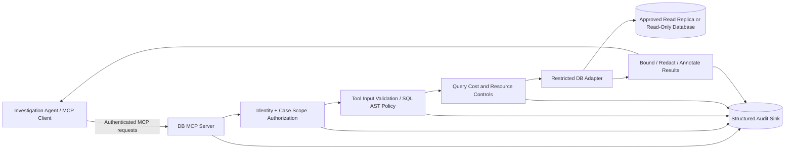

# Implementation Prompt — Secure Read-Only Database MCP Server

You are a senior backend engineer and security-conscious systems architect. Build a **standalone, production-oriented, read-only Database Model Context Protocol (MCP) Server** that an autonomous Investigation Agent can use to inspect database structure and collect bounded, reproducible evidence. Implement the system in this repository, rather than merely producing a design proposal.

## 1. Mission and boundaries

The server must enable an AI agent to **explore approved schemas, understand table relationships, inspect safe query plans, and run tightly controlled analytical SELECT queries**. The agent chooses what to investigate; the server enforces what it is allowed to access. The design must be **generic, not CyberArk-specific**: CyberArk/IAM investigations are an example use case, not a source of hard-coded business rules.

**In scope:** MCP tool endpoints, database adapter, dialect-aware SQL policy enforcement, request authorization, output redaction and bounding, configuration, audit logging, tests, and documentation.

**Out of scope:** The investigation agent's reasoning loop, chat UI, repository/codebase search, remediation tools, database mutations, privileged credential management, and executing arbitrary shell commands on behalf of an agent.

Never add database write tools or an unrestricted SQL/administrative execution escape hatch. **A prompt saying “read-only” is not a security control.** Enforce it at multiple layers and fail closed.

## 2. Reference architecture



**Security invariant:** Effective access is the intersection of (a) authenticated caller entitlements, (b) approved investigation/source scope, (c) server-side tool policy, and (d) the actual database account's privileges. The model may propose query parameters, but **must not be allowed to self-assert an `actor_id`, escalate `case_id`, change database credentials, or expand source scopes**.

## 3. MCP tool contract

Implement these six tools (names may use a consistent namespace, but document exact names). Return **structured, machine-readable responses** with error codes and source provenance:

1. `list_schemas()` — Enumerate only authorized schemas.
2. `list_tables(schema)` — Enumerate only authorized tables/views within an authorized schema.
3. `describe_table(schema, table)` — Return permitted column names/types, nullable flags, primary/unique keys, and safe descriptions. Do not expose prohibited columns or metadata.
4. `get_relationships(schema, table)` — Return authorized foreign keys and, where configured, documented joins. Do not invent relationships; distinguish inferred relationships from declared constraints if optional inference is implemented.
5. `explain_read_query(sql, parameters?)` — Parse and authorize the query, then return a **non-executing, dialect-appropriate plan** or explain why a safe plan cannot be provided. Never use `EXPLAIN ANALYZE` or any mode that executes the query. Apply plan/cost gating where reliable.
6. `execute_read_query(sql, parameters?, limits?)` — Execute an authorized, parameterized, bounded, read-only statement, then return redacted results with explicit truncation and evidence metadata.

Treat tool input as untrusted. Enforce per-argument schemas and server-side defaults/maxima. `schema`, `table`, and column identifiers must come from authorized metadata or be securely quoted after allowlist checks; **bind parameters for data values** using the driver, never SQL string concatenation. Do not use user-provided table/schema names to compose unchecked SQL.

## 4. Mandatory read-only and SQL controls

Implement **defense in depth**, not a superficial `sql.trim().startsWith('SELECT')` check:

- Connect with a **dedicated, least-privilege database identity** limited to approved schemas/tables/views/columns, with no write/DDL/admin access. Prefer a reporting view or read replica. Document the SQL/grants the DBA must provision; do not grant privileges from the MCP server.
- Where the target DB supports it, use a native read-only transaction/session and statement timeout. Do not assume this mechanism exists or behaves identically in every dialect.
- Parse SQL with a **dialect-aware parser/AST**; deny unknown or unsupported constructs. Allow only a carefully defined query subset (e.g., SELECT and explicitly vetted read-only CTEs). Require exactly one statement.
- Explicitly reject INSERT, UPDATE, DELETE, MERGE, CREATE, ALTER, DROP, TRUNCATE, GRANT, REVOKE, CALL, EXEC, COPY, file export/import, SELECT INTO, `FOR UPDATE`, multi-statements, driver escape syntax, dangerous session changes, and any executable or side-effecting construct.
- Reject user-defined/stored functions, unapproved built-ins, or any function whose behavior cannot be positively classified as safe. Include a configurable, dialect-specific **function allowlist**; do not rely on a generic blacklist.
- Recursively verify referenced schemas, relations, columns, subqueries, CTEs, joins, and set operations against source-level access policy. Deny metadata/system schemas by default unless explicitly approved.
- Limit `LIMIT`/pagination and **independently enforce a server-side maximum**; an attacker must not evade it with nesting or alternate syntax. Use a database-driver fetch cap and response-byte cap as a second line of defense. Never represent the returned subset as the full population.
- Bound execution time, maximum rows, result bytes, concurrency, and per-actor/per-case query budgets. Prefer a read replica. Reject or gate costly plans; when safe cost estimation is unavailable, use conservative limits and record the limitation.
- Secrets, password hashes, credential blobs, private keys, connection strings, and disallowed PII must never reach the model. Prefer excluding sensitive sources **before query execution**; apply column/value redaction as a backup before serialization, audit, caching, or error reporting.
- Disable unauthorized outbound network access, credential exposure, and arbitrary filesystem/shell execution. Treat database text as **untrusted evidence**, never as instructions.

**Important:** A SQL parser alone does not guarantee read-only semantics. Native DB privileges and server-enforced policies are both mandatory. If a dialect feature cannot be validated reliably, **reject it**.

## 5. Identity, tenancy, and transport

- Support an explicit development mode and a secure production mode. In production, reject unauthenticated network clients; use the chosen MCP transport's appropriate authentication and TLS arrangements behind a trusted gateway where needed.
- Derive identity and allowed investigation/source scope from a **trusted, authenticated server context**, not from model-editable MCP tool arguments. If a trusted authorization service is unavailable, use a restrictive single-principal deployment and clearly document that limitation. Never claim per-user authorization that is not actually implemented.
- Prevent cross-user, cross-case, or cross-tenant information leakage, including caches, diagnostics, metadata tools, and auditing.
- Secrets/configuration are loaded from environment variables or a secrets manager and never echoed in tool responses. No hard-coded production credentials.
- For local `stdio` MCP deployments, document that the server runs with its host process's trust and permissions; `stdio` itself is **not** an independent user-authentication boundary.

## 6. Standard result and error envelope

All tools should return a coherent contract, broadly like:

```json
{
  "status": "success",
  "tool": "execute_read_query",
  "request_id": "req_...",
  "evidence_id": "ev_...",
  "source": {
    "datasource_id": "approved_reporting_db",
    "environment": "reporting",
    "schema_scope": ["approved_schema"],
    "observed_at": "<ISO-8601 timestamp>",
    "consistency_note": "Read replica; replication lag may apply"
  },
  "columns": [{"name": "status", "type": "string"}],
  "rows": [{"status": "INACTIVE"}],
  "row_count_returned": 1,
  "truncated": false,
  "limits_applied": {"max_rows": 100, "timeout_ms": 3000},
  "redactions": [],
  "warnings": []
}
```

Adapt the shape per tool. An empty result, truncated result, timeout, stale replica, and explicitly computed `COUNT(*)` are **different things**; do not conflate them. Include a stable request/evidence ID and timing/coverage provenance suitable for correlation with an Investigation Agent's evidence ledger. Never expose raw driver exceptions or secrets. Use clear typed errors such as `ACCESS_DENIED`, `QUERY_REJECTED`, `QUERY_TOO_EXPENSIVE`, `TIMEOUT`, `RESULT_TRUNCATED`, `SOURCE_UNAVAILABLE` and `CONFIGURATION_ERROR`.

## 7. Audit and observability

Emit structured audit events for each call: timestamp, trusted actor/case identifiers if available, tool name, data source, normalized/redacted SQL or SQL fingerprint, policy decision, duration, rows/bytes returned, truncation, redaction categories, and error code. **Do not log raw sensitive query parameters, credential material, or full returned rows.** Add metrics for rejection rates, timeouts, resource use, and query frequency; correlate everything through request/evidence IDs.

## 8. Technology and implementation decisions

1. **First inspect this repository.** Preserve established language/framework/build conventions if they are suitable. If this is an empty repository and there is no project mandate, default to **Python 3.12+**, the maintained official MCP Python SDK, a mature DB abstraction/driver, and a dialect-aware SQL parser. Pin dependencies with a lockfile. Do not invent library APIs; verify the installed package interfaces before implementation.
2. Implement a **pluggable database dialect/adapter interface**, but make **one explicitly configured SQL dialect fully working and well-tested first**. Do not falsely claim full portability across MySQL, PostgreSQL, SQL Server, Oracle, and other engines. Unsupported dialects/features must fail safely.
3. Separate MCP transport, authentication/context, metadata access, policy evaluation, SQL AST validation, execution, redaction, audit, and configuration into testable modules.
4. Keep the business domain out of the MCP server. The agent determines which questions/queries matter; the MCP server never decides whether a CyberArk account is healthy.
5. Provide a safe local/demo setup using synthetic data and a **test-only** DB identity. Document the production read-only account, schema allowlist, TLS, pool sizing, budgets, and secret-injection deployment configuration.

## 9. Build plan and required deliverables

Proceed end to end, without stopping at a concept document:

**Step A — Repository assessment:** Summarize the existing code structure, database targets, available tooling, and any requirements that cannot be inferred. Make sensible documented choices for unspecified details. Do not request live credentials.

**Step B — Contracts and threat model:** Specify exact MCP tools and typed schemas; document trust boundaries, supported dialect, permitted AST node/function set, and threat scenarios.

**Step C — Working implementation:** Build the server and all six tools, including positive authorization, strict SQL validation, bounded execution, safe output, and audits. The default configuration must be secure. Unsupported features should return explicit errors, not silently bypass enforcement.

**Step D — Tests:** Provide unit and integration tests using disposable synthetic databases plus mock/stub policy contexts. Include authentication/scope tests and adversarial SQL tests. A green test suite is mandatory before claiming completion.

**Step E — Operational documentation:** Provide `README.md` with startup, MCP client connection example, config reference, required grants, demo workflow, and limitations; `docs/security.md`, `docs/tool-contracts.md`, `.env.example` with dummy values, and deployment notes. Include a Mermaid architecture and at least one query sequence diagram.

**Step F — Demonstration:** Show a reproducible agent-like sequence: discover schemas → inspect table → inspect relationships → explain an analytical SELECT → execute safe query → consume evidence metadata. Include a negative example of a rejected unsafe query.

## 10. Security-focused acceptance tests

At a minimum, cover:

- Authorized versus forbidden schemas/tables/columns; metadata cannot leak blocked objects.
- No auth / forged actor or case / cross-tenant scope escalation (for deployments supporting multiple principals).
- Multiple SQL statements, comments/obfuscation, nested queries, CTEs, UNION bypass attempts, unexpected AST nodes.
- Write/DDL/procedure/function side effects, unsafe exports, unsafe locks, unsafe plan-execution modes.
- Parameters that look like SQL injection; safe identifier validation; malformed SQL.
- Too many rows, oversized fields, slow queries, expensive plans, rate-limit/concurrency exhaustion.
- Sensitive field exposure through query results, errors, logs, and metadata.
- Timeout, connection failure, truncated result, replica staleness, and unknown/unsupported dialect behavior.
- Positive tests for ordinary SELECT, JOIN, GROUP BY, safe aggregations, and approved read-only CTEs where supported.

**A feature is not complete if it works on ordinary SQL but allows a forbidden query or leaks secrets.** Do not substitute mock-only “security checks” for actual enforcement in the database adapter and policies.

## 11. Definition of done

The deliverable is a running, documented MCP server that an Investigation Agent can connect to and use to explore approved DB metadata and execute safe, bounded, read-only queries. Its authorization, SQL restrictions, output redaction, query budgets, error semantics, and audit trail are enforced and demonstrated by tests. It **never needs the agent to behave safely in order to be safe**.

After implementation, report: exact run commands, implemented tool names, supported dialect(s), verified security controls, automated test results, known limitations, and next recommended improvements. If full production security depends on externally provisioned DB privileges, TLS, an identity gateway, or a secrets manager, state that dependency explicitly; do **not** assert production readiness until those prerequisites are validated.
