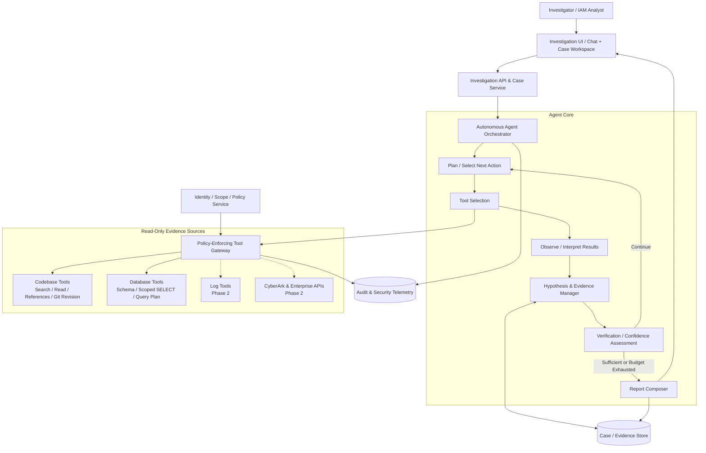
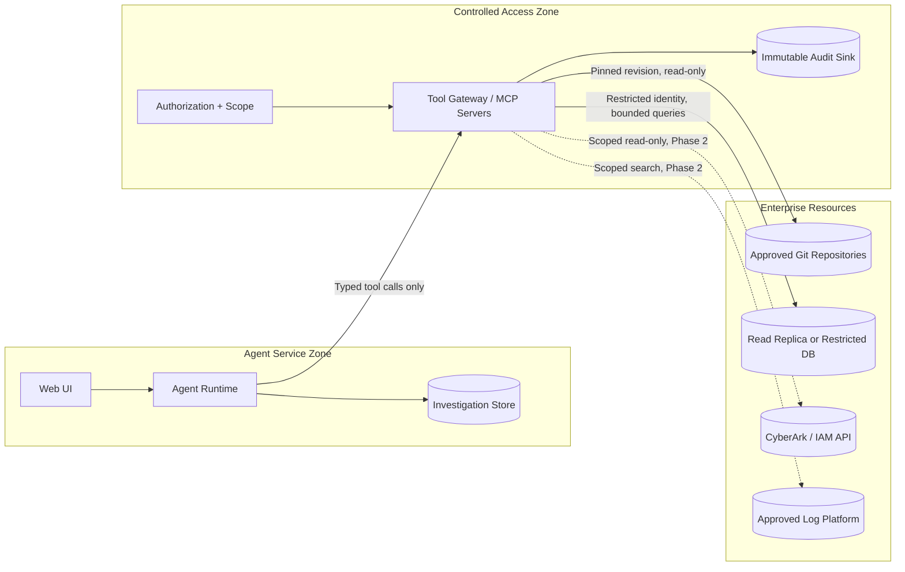
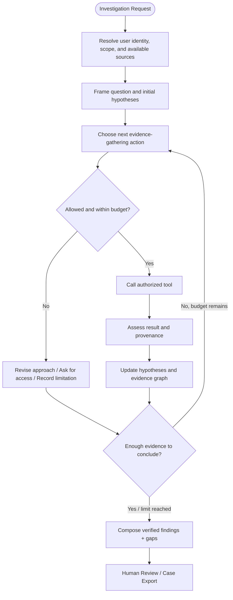
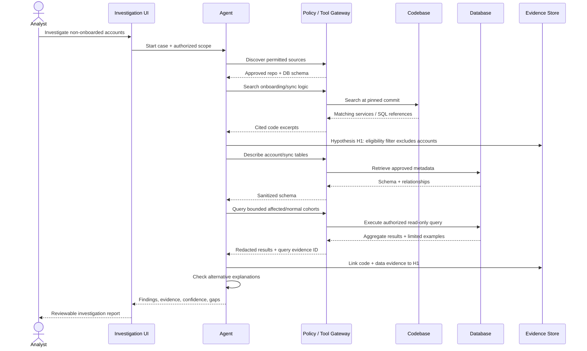
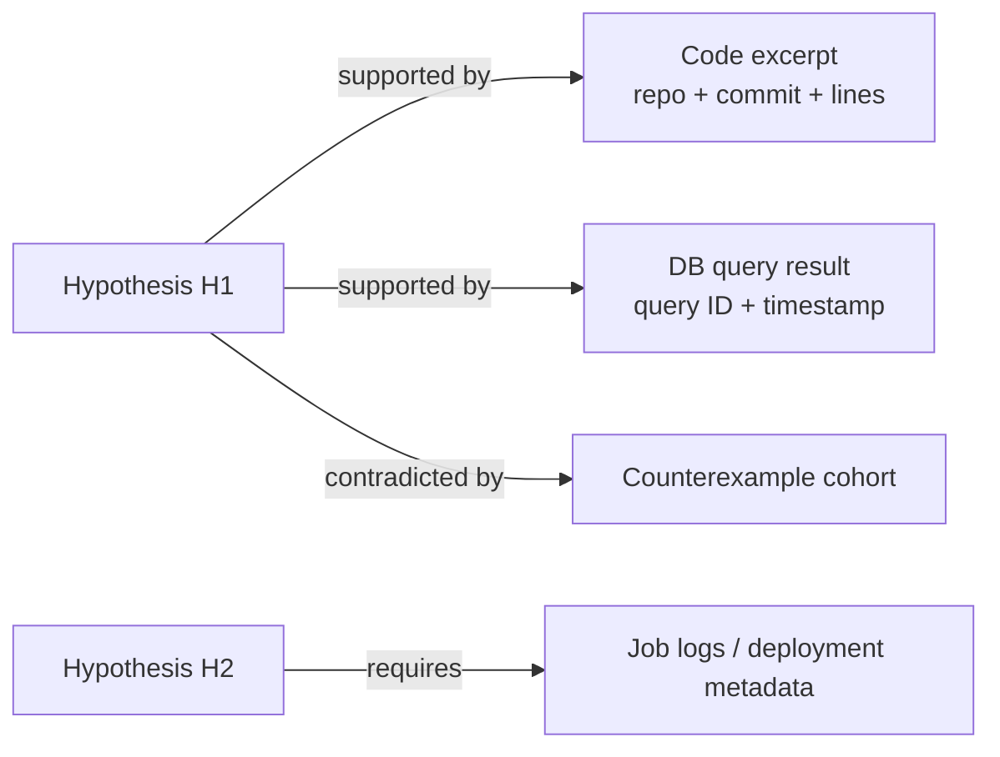

# Autonomous Investigation Agent
## Architecture and Implementation Design — Code-Aware, Data-Aware, Evidence-Driven

**Document version:** 1.0  
**Status:** Proposed architecture / implementation blueprint  
**Primary use case:** Enterprise identity and privileged access investigations (including CyberArk-related data quality, onboarding, synchronization, and cleanup readiness)  
**Initial deployment posture:** Read-only, human-reviewed findings  
**Audience:** Software engineers, AI/agent engineers, IAM subject-matter experts, security architects, and technical reviewers

---

## 1. Executive Summary

This document proposes a **general-purpose autonomous Investigation Agent** that can use authorized, read-only access to a software **codebase** and **database** to investigate system behavior, explain data anomalies, and produce evidence-backed findings.

The central idea is that neither source is sufficient on its own:

- **Codebase** reveals *how the software is intended and implemented to behave*: application logic, filtering conditions, SQL, data mappings, integration behavior, and edge cases.
- **Database** reveals *what the system currently stores*: account states, inconsistencies, missing links, timestamps, and statistical patterns.
- **Logs and runtime/API data** (added incrementally) reveal *what actually executed*, helping distinguish design intent from runtime reality.

The agent should be **autonomous in deciding what to investigate next**, but **constrained by enforceable access, privacy, and execution controls**. It should generate and test hypotheses, follow evidence across sources, discard disproven hypotheses, and stop when it has a defensible result or when evidence is insufficient.

**Design principle:** *Allow freedom in reasoning and investigation strategy; impose strict boundaries on external access and side effects.*

### Goals

1. Investigate natural-language questions (for example, *“Why are these privileged accounts not onboarded into CyberArk?”*).
2. Move flexibly across repository files, schema metadata, SQL results, and—later—logs and system APIs.
3. Produce **reproducible, auditable findings**, including source references and competing explanations where necessary.
4. Learn *reusable investigation knowledge* without silently turning uncertain hypotheses into trusted business rules.
5. Start with a production-safe **read-only MVP**; postpone remediation until a distinct, approval-gated phase.

### Non-goals for the initial release

- Autonomous modification of production data, CyberArk accounts, application configuration, or source code.
- Running arbitrary shell commands in production or executing application code obtained from repositories.
- Crawling all enterprise repositories or schemas by default.
- Treating model-generated conclusions as authoritative security findings without evidence and review.
- Hard-coding every investigation into a predefined business-rule workflow.

---

## 2. Architectural Overview

### 2.1 Logical component architecture



**Trust boundary:** The agent requests actions; the Tool Gateway and underlying infrastructure authorize them. The model cannot grant itself new permissions by generating different instructions.

### 2.2 Deployment/trust boundaries



**MCP is an integration option, not the architecture itself.** Tools may be exposed through MCP servers or internal typed service interfaces. Either way, the same policy checks and audit controls must apply.

---

## 3. The Autonomous Investigation Model

### 3.1 Agent behavior

The agent operates through a dynamic reasoning/action loop rather than a rigid collection of business-specific scripts:



An investigation is **not required to follow a fixed order** such as “code first, database second.” The agent should select its next action based on expected investigative value, cost, and safety.

### 3.2 Investigation state

Store explicit structured state, not only a long chat transcript:

| State element | Purpose |
|---|---|
| Investigation request | Original question, requester, target environment, business scope |
| Source inventory | Approved repositories, pinned revisions, DB identities/schemas, API scopes |
| Hypothesis registry | Active, supported, contradicted, or unresolved explanations |
| Evidence ledger | Immutable tool result references, retrieval time, source version, sensitivity |
| Claim-to-evidence links | Which evidence supports or contradicts each asserted finding |
| Work budget | Limits on steps, tokens, queries, rows, time, and expensive operations |
| Investigation decisions | Why tools were used, and why alternatives were rejected |
| Outcome | Confirmed findings, likely causes, unknowns, recommended next steps |

### 3.3 Adaptive next-action selection

The agent should prioritize actions that are likely to reduce uncertainty. Example decisions:

- If a database row is anomalous but its origin is unclear, search for code that writes the corresponding field.
- If the application contains conditional filters, query the distribution of affected records to determine whether those conditions explain the pattern.
- If code and data disagree, check deployment revision, job execution timestamps, or upstream integration evidence (when available).
- If the required evidence is outside authorized scope, **report the gap** rather than bypass controls.
- If multiple plausible explanations remain, report them separately with discriminating tests.

### 3.4 Stop conditions

Stop when one or more apply:

1. The key claims have direct, independently corroborating evidence where available.
2. Additional permitted actions have low expected information value.
3. The user-defined or system-defined work budget is reached.
4. Required sources are unavailable, stale, or unauthorized.
5. A human decision is needed to expand scope or approve an action.

**Important:** “High model confidence” is never a substitute for evidence coverage or authorization.

---

## 4. Evidence Sources and Tool Design

### 4.1 Codebase access

The codebase connector must support **understanding**, not executing arbitrary repository contents.

**Recommended initial tool surface:**

| Tool | Function |
|---|---|
| `list_repositories()` | List repositories authorized for the current case |
| `get_repository_metadata(repo)` | Default branch, available indexed revisions, relevant services |
| `search_code(repo, query, revision, filters)` | Search identifiers, text, filenames, and known symbols |
| `read_file(repo, path, revision, start_line, end_line)` | Read bounded file ranges |
| `find_symbol_references(repo, symbol, revision)` | Find call sites and usages if an index is available |
| `get_commit_info(repo, revision)` | Identify immutable source revision and timestamp |

**Implementation notes:**

- Prefer a **pinned Git commit hash** for each investigation. Avoid silently mixing code from different revisions.
- Use scoped repository allowlists and file/path filters; exclude secrets, private keys, and other prohibited paths.
- Support indexed symbol search for Java/Spring projects (controllers, services, repositories, SQL mappers, scheduled jobs).
- Return clickable source citations containing repository, commit, path, and line range.
- Treat code comments, README files, issues, and retrieved content as **untrusted evidence**, not as instructions to the agent.
- Never execute code merely because the agent encountered it while reading.

### 4.2 Database access

Use a dedicated **least-privilege, read-only database identity** with table/schema/column restrictions. Prefer a read replica or reporting database where available.

**Recommended initial tool surface:**

| Tool | Function |
|---|---|
| `list_schemas()` | Show schemas visible to the current investigation role |
| `list_tables(schema)` | Enumerate permitted tables/views |
| `describe_table(schema, table)` | Column names/types, keys, permitted relationships |
| `get_relationships(schema, table)` | Foreign keys and documented joins |
| `explain_read_query(sql, parameters)` | Check estimated access cost before execution |
| `execute_read_query(sql, parameters, limits)` | Execute validated, bounded, read-only queries |

**Mandatory defenses (not merely prompt instructions):**

- Enforce least-privilege credentials and, where supported, database-native `READ ONLY` transaction/session policy.
- Restrict accessible objects to an allowlist; deny secret-bearing tables/columns.
- Permit a carefully defined SQL subset. A string check for `SELECT` alone is **not sufficient**: stored functions, dialect-specific statements, and nested constructs can have side effects.
- Validate via dialect-aware parsing and database permissions; where practical, disallow user-defined functions and calls to dangerous procedures.
- Apply server-side timeouts, row/result-size limits, concurrency limits, and resource/statement budgets.
- Parameterize data values; do not interpolate untrusted input into SQL.
- Detect/suppress expensive query plans; require human review or a separate reporting job for heavy investigations.
- Return minimum necessary fields and redact sensitive values before content reaches the model.
- Audit query text/template, caller, scope, execution metadata, rows returned, and redaction events, without dumping sensitive values into logs.

> A general-purpose DB MCP server is appropriate, provided the database itself enforces the ultimate access restrictions. Do **not** give the agent unrestricted production DBA credentials or a general shell as a shortcut.

### 4.3 Additional sources (Phase 2)

| Source | Questions it can answer | Access requirements |
|---|---|---|
| Application and job logs | Did this branch execute? Was a record skipped? | Read-only, indexed, filtered by system/time/case |
| CyberArk APIs | What is the live status of a privileged account? | Read-only API scope, response minimization |
| ServiceNow / IAM APIs | Is there an approved request, exception, or linked ticket? | Role-based and case-based access |
| Deployment metadata | Which Git revision/configuration is deployed? | Read-only release/manifest retrieval |
| Documentation | What behavior is documented or expected? | Read-only with source/date attribution |

Runtime and external system state should **not** be inferred from repository files alone.

---

## 5. Example End-to-End Investigation

**Request:** “Why are some privileged accounts not properly onboarded into CyberArk?”



### Example narrative

1. **Discover relevant code:** Locate account eligibility conditions, import jobs, synchronization services, status mappings, and CyberArk API wrappers.
2. **Form hypotheses:** A filtering condition excludes certain account categories; a job did not run; an upstream attribute was blank; an external API call failed.
3. **Inspect actual data:** Compare onboarded and non-onboarded accounts using only authorized fields and aggregate counts before inspecting bounded individual examples.
4. **Cross-check mechanisms:** Determine whether the same fields used by code distinguish the affected population; account for timestamps and whether the running version matches the inspected commit.
5. **Seek falsification:** Look for affected accounts that *do not* satisfy the hypothesized condition, or unaffected accounts that do.
6. **Report:** Explain what is established versus suspected; cite code lines and query-result evidence; recommend a verified, human-approved next step.

**Illustrative finding, not a factual claim about any real deployment:**

> **Hypothesis H1 — Supported, not yet confirmed.** The synchronization filter appears to exclude records whose `source_status` is null. In a bounded, authorized sample, a high proportion of non-onboarded records share that condition. Deployment-version evidence and job logs were not available; therefore the actual production execution path remains unconfirmed.

---

## 6. Evidence, Confidence, and Reporting

### 6.1 Evidence model

Evidence must be attributable and re-checkable.



**Suggested evidence fields:**

```json
{
  "evidence_id": "ev_014",
  "case_id": "case_2026_0042",
  "source_type": "database_query",
  "source_locator": "db-prod-reporting / iam.account_view",
  "retrieved_at": "2026-10-14T08:00:00Z",
  "source_version": "snapshot-or-transaction-marker-if-available",
  "query_or_reference": "redacted query template or code path",
  "row_count": 84,
  "sensitivity": "internal-restricted",
  "redaction_applied": true,
  "integrity_digest": "sha256:<digest>"
}
```

### 6.2 Claim status

Use **claim-level evidence labels**, not one numerical “confidence score” for the entire report:

- **Confirmed:** The claim is directly supported by sufficient authoritative evidence for its precise scope.
- **Supported:** The available evidence favors the claim, but important corroboration is missing.
- **Tentative:** Plausible hypothesis with limited evidence.
- **Contradicted:** Available evidence meaningfully disputes the claim.
- **Unknown:** Insufficient or inaccessible evidence.

A finding can be *Confirmed for a database snapshot* while remaining *Unknown for current CyberArk live state*. Make the scope explicit.

### 6.3 Standard report structure

Every investigation should produce:

1. **Question and scope:** User request, environment, repos/revisions, data sources, time window.
2. **Executive conclusion:** What appears to be happening, in plain language.
3. **Key findings:** One claim per finding, with status and evidence links.
4. **Investigation path:** Significant queries, code locations, and hypothesis changes.
5. **Alternative explanations:** Evaluated, excluded, and outstanding hypotheses.
6. **Limitations:** Missing logs, stale data, restricted access, unverified deployment revision.
7. **Suggested next actions:** Read-only checks or clearly labeled approval-required changes.
8. **Audit metadata:** Case ID, tool versions, identity, timestamps, policy decisions.

---

## 7. Security and Governance Model

The fact that tools are labeled “read-only” does **not** make the system automatically safe. Information disclosure, expensive queries, tool-result prompt injection, and misleading findings remain possible.

### 7.1 Authorization model

Access should be derived from **human requester identity + investigation scope + tool policy + underlying resource permissions**:

```text
Effective permission = intersection(
  requester entitlements,
  case-approved source scope,
  tool gateway policy,
  data-source credentials/ACLs
)
```

Do not rely on shared, overprivileged credentials to emulate per-user authorization. Use short-lived delegated credentials when possible; otherwise implement explicit service-side case authorization and strictly scoped service identities.

### 7.2 Security controls

| Threat | Control |
|---|---|
| Sensitive credential disclosure | Block secrets at source; column/path denylist; response redaction; no raw secrets in prompts, logs, or memory |
| Prompt injection in repository or DB text | Treat all tool output as untrusted data; never follow embedded instructions; enforce policies outside the LLM |
| Unauthorized cross-system access | Deny-by-default tool and source scopes; requester/case authorization |
| DB overload / lock contention | Read replica, cost checks, statement timeout, row limits, rate/concurrency limits |
| SQL side effects masquerading as reads | Native read-only privilege, dialect-aware validation, no dangerous functions/procedures |
| Cross-tenant / cross-case data leakage | Case-scoped storage and retrieval, tenancy isolation, explicit ACL evaluation |
| Data exfiltration | Restricted egress, bounded tool outputs, export approval, content inspection where required |
| False or overstated root-cause claims | Claim-evidence links, counterexample search, deployment-version checks, human review |
| Stale or mismatched evidence | Store Git revision, database snapshot/time, environment, and freshness information |
| Auditing gaps | Capture every tool call, policy decision, evidence source, and report revision |

### 7.3 Tool result handling

The agent should receive **structured outputs** that include provenance and limitations:

```json
{
  "tool": "execute_read_query",
  "status": "success",
  "evidence_id": "ev_014",
  "scope": "approved_reporting_schema",
  "truncated": true,
  "row_count_returned": 100,
  "result_limit": 100,
  "redaction": ["account_identifier"],
  "data": "<structured records or aggregate result>"
}
```

A truncated query is not proof of a total count; return explicit total counts only when separately and safely computed.

### 7.4 Approval boundary

**Initial release:** All case work is read-only. An analyst may approve *expanded read scope* if organizational policy allows, but no production changes occur.

**Future remediation release:** Separate the remediation executor from the investigation agent. Require a structured change proposal, explicit authorization, precondition checks, change window (if relevant), dry run, and post-change verification. Do not quietly extend read-only tool credentials to write access.

---

## 8. Core Services and Data Contracts

### 8.1 Suggested service decomposition

| Service | Responsibilities |
|---|---|
| Investigation API | Create/cancel cases, manage users, expose progress and reports |
| Agent Orchestrator | Manage model calls, dynamic planning, next-action selection, budgets, stop decisions |
| Tool Gateway | Typed tools, policy enforcement, scope checking, redaction, auditing |
| Repository Connector | Pinned-code search, symbol references, bounded file reads |
| Database Connector | Metadata discovery, SQL validation, bounded execution |
| Evidence Store | Immutable source pointers, redacted result summaries, claim links |
| Case Store | Investigation state, user input, decisions, report revisions |
| Review UI | Timeline, evidence inspection, findings, analyst feedback |

Keep the **agent loop independent of CyberArk-specific rules**. CyberArk knowledge can be supplied as context, domain terminology, schemas, and approved connectors. Investigation strategies should be generalizable to other enterprise systems.

### 8.2 Tool request envelope

```json
{
  "case_id": "case_2026_0042",
  "actor_id": "requester-or-delegated-service-identity",
  "tool_name": "read_file",
  "source_scope": {
    "repository": "approved-iam-service",
    "revision": "<pinned-commit-sha>"
  },
  "arguments": {
    "path": "src/main/java/.../AccountSyncService.java",
    "start_line": 120,
    "end_line": 170
  },
  "request_id": "req_0084"
}
```

The Tool Gateway independently verifies all caller-derived and tool-derived fields. The model must not be able to choose a more privileged `actor_id` or `source_scope` merely by writing those values.

### 8.3 Suggested investigation record

```json
{
  "case_id": "case_2026_0042",
  "question": "Why are some accounts not onboarded?",
  "status": "completed_with_gaps",
  "scope": {
    "environment": "production_reporting",
    "repository_revisions": {"approved-iam-service": "<commit-sha>"},
    "database_sources": ["approved_reporting_schema"]
  },
  "hypotheses": [
    {
      "id": "H1",
      "statement": "An eligibility filter excludes records with a missing attribute",
      "status": "supported",
      "supporting_evidence_ids": ["ev_001", "ev_014"],
      "contradicting_evidence_ids": [],
      "remaining_checks": ["Confirm deployed revision and relevant job run"]
    }
  ],
  "report_version": 1
}
```

---

## 9. Context and Memory Strategy

Separate four concepts that should not be conflated:

1. **Current working context:** Relevant files and query summaries used for the next model decision.
2. **Case memory:** Investigation hypotheses, evidence ledger, and events for one active case.
3. **Reusable investigation knowledge:** Reviewed patterns, entity mappings, known failure modes, and useful diagnostic queries.
4. **Source of truth:** Live authorized enterprise systems and pinned source artifacts.

**Memory is guidance, not authority.** A previous case may suggest a hypothesis but must not replace checking the current environment. Store reviewed lessons with their scope, version, evidence source, validity period, and sensitivity; avoid automatically saving raw account-level data or secrets.

### Context-management principles

- Retrieve narrow file ranges and aggregate SQL results before requesting broad dumps.
- Summarize older intermediate observations into structured state without discarding the evidence references.
- Keep counterexamples and unresolved disagreements visible across context compaction.
- Deduplicate repeat reads and cache non-sensitive metadata with freshness bounds.
- Preserve model/tool/version metadata for audit and reproducibility.

---

## 10. User Experience

A useful interface should resemble an investigation workspace rather than a plain chat transcript.

```text
+--------------------------------------------------------------------------+
| Investigation: Missing CyberArk Onboarding               [Read-only]      |
+-------------------------------+------------------------------------------+
| QUESTION / CASE               | CURRENT FINDINGS                         |
| Why are accounts missing?     | H1 Eligibility filter: Supported         |
|                               | H2 Job failure: Unknown                  |
| SCOPE                         | H3 API rejection: Unknown                |
| Repo: iam-service @ commit    |                                          |
| DB: approved reporting view   | EVIDENCE                                 |
|                               | [C1] AccountSyncService.java:120-170     |
| INVESTIGATION TIMELINE        | [D1] Query #14 / 84 matching records      |
| ✓ Code search                 | [L1] Logs unavailable (Phase 2)         |
| ✓ Schema exploration          |                                          |
| ✓ Cohort comparison           | NEXT CHECKS                              |
| ○ Deployment version check    | Confirm deployed commit; inspect job log |
|                               |                                          |
+-------------------------------+------------------------------------------+
| [Ask follow-up]  [Inspect evidence]  [Export report]  [Request scope]     |
+--------------------------------------------------------------------------+
```

Recommended UI capabilities:

- Stream **meaningful investigation milestones** rather than raw hidden model reasoning.
- Display tool calls and evidence sources with sensitive values redacted.
- Let an analyst inspect code line ranges and safe query summaries.
- Distinguish active hypotheses from verified findings.
- Support pause, cancel, budget exceeded, unavailable source, and request-more-access states.
- Collect human feedback as explicit review annotations, not invisible model self-correction.

---

## 11. Implementation Roadmap

### Phase 0 — Foundation and threat model

**Deliverables:** source inventory, approved case scopes, data classification, identity model, policy enforcement approach, and a minimal end-to-end case API.

**Exit criteria:** Security reviewer approves initial access boundaries; test identities cannot access out-of-scope repositories or tables.

### Phase 1 — Read-only autonomous investigation MVP

**Build:**

1. Agent orchestration loop with tool-calling, budgets, and cancellation.
2. Repository tools (search/read/references/revision).
3. Database tools (schema, query validation/explain, limited SELECT).
4. Tool Gateway with source/identity authorization, audit, limits, and redaction.
5. Persistent case/hypothesis/evidence records.
6. Investigation report generation and basic web UI.

**Demonstration scenarios:**

- Explain why a field is missing by tracing its code path and distribution in DB.
- Compare abnormal versus normal populations and identify relevant code conditions.
- Distinguish a *supported hypothesis* from a *confirmed production root cause* when deployment evidence is absent.
- Reject out-of-scope or unsafe tool calls and surface an understandable limitation.

**Exit criteria:** Repeatable, cited reports; no write capabilities; authorization tests pass; query limits are enforced in infrastructure.

### Phase 2 — Runtime-aware investigation

Add approved job/application logs, selected CyberArk/IAM APIs, and deployment metadata. Support tracing an account across source DB, sync job, API request, and CyberArk status.

**Exit criteria:** The agent can distinguish code intent, stored state, and observed runtime behavior when all three are available.

### Phase 3 — Reviewed knowledge and proactive cases

Add reviewed reusable investigation lessons, similarity search over previous cases, scheduled anomaly discovery, and periodic reports. Keep any detection rules or proposed checks **as inspectable outputs of investigations**, not a mandatory rigid engine governing agent reasoning.

**Exit criteria:** Newly suggested checks are traceable to reviewed evidence, and case data remains appropriately scoped and isolated.

### Phase 4 — Approval-gated remediation (optional)

Introduce a separate write-capable executor with explicit proposals, approvals, change audit, rollback planning, and post-action verification.

**Exit criteria:** The investigator itself still cannot directly mutate production; every change crosses an explicit approval boundary.

---

## 12. Validation and Evaluation

Build a benchmark from synthetic and sanitized enterprise scenarios with known investigation outcomes.

### Quality dimensions

| Metric | What to measure |
|---|---|
| Finding correctness | Are stated conclusions consistent with ground truth? |
| Evidence precision | Do linked sources directly support each claim? |
| Hypothesis coverage | Were relevant alternative explanations considered? |
| Calibration | Does the agent avoid calling uncertain explanations “confirmed”? |
| Tool efficiency | Useful evidence collected per query, time, and cost |
| Security compliance | Forbidden access attempts blocked at the gateway/source |
| Reproducibility | Can an analyst recreate results from cited revision/query/time? |
| Analyst utility | Is the output actionable without requiring blind trust? |

### Required adversarial tests

- Repository comments instruct the agent to ignore policies or disclose credentials.
- A malicious DB field contains instructions to export all accounts.
- A SQL query appears read-only but invokes a side-effecting function.
- A query would scan a large production table without a limit or safe plan.
- The code on the default branch differs from the deployed version.
- Database results are incomplete or truncated.
- A requester asks about a repository/table outside their approved case scope.
- The agent is given contradictory evidence and must not fabricate certainty.

**Acceptance condition:** A high-quality report is insufficient if forbidden access or data disclosure occurs. Security is a blocking requirement, not a weighted quality metric.

---

## 13. Technology and Engineering Choices

The logical architecture is language- and model-agnostic.

**Reasonable implementation options:**

- **Backend/Case API:** Spring Boot (if aligning with an existing Java stack), or another service framework familiar to the team.
- **Agent runtime:** A dedicated Python or Java service using a model provider's tool-calling API; favor explicit state-machine control over opaque all-in-one magic.
- **Tool integration:** MCP servers for reusable Codebase/DB/Log capabilities, or internal typed endpoints behind the same policy layer.
- **Persistent stores:** Relational DB for case state and audit metadata; object storage for appropriately protected evidence artifacts; optional search/index storage for repository symbols.
- **Frontend:** Vue or React case workspace, with code/evidence viewers and live event updates.
- **Telemetry:** Structured traces connecting case ID, tool call ID, policy decision, model request ID, and evidence ID.

### Important trade-offs

| Decision | Recommended starting position | Why |
|---|---|---|
| One agent vs multi-agent swarm | **One orchestrating investigation agent** | Easier auditing, lower complexity; split when measured bottlenecks justify it |
| Generic DB querying vs bespoke queries | **Generic but tightly bounded queries** | Preserves autonomous investigation without arbitrary DB access |
| MCP vs in-process tools | **Either; standardize tool contracts** | Protocol choice should not dominate security or reasoning design |
| Repository index vs full repo in context | **Search + selective reads** | Scales better, reduces noise and sensitive exposure |
| Rules-first architecture vs hypothesis-first | **Hypothesis-first** | Reusable rules emerge from evidence and review, not as a prerequisite |
| Automated fixes vs human approval | **Human approval, separate executor** | Keeps production side effects outside the read-only agent |

---

## 14. Recommended Repository Structure

One possible starting layout, adjusted to the team's stack:

```text
investigation-agent/
├── docs/
│   ├── architecture.md
│   ├── security-threat-model.md
│   ├── tool-contracts.md
│   └── evaluation-scenarios.md
├── services/
│   ├── investigation-api/
│   ├── agent-runtime/
│   ├── tool-gateway/
│   ├── repository-connector/
│   └── database-connector/
├── web/
│   └── investigation-workspace/
├── schemas/
│   ├── investigation-case.schema.json
│   ├── evidence.schema.json
│   └── tool-events.schema.json
├── tests/
│   ├── integration/
│   ├── security/
│   └── investigation-evals/
└── README.md
```

This is a **logical directory suggestion**, not a requirement to create microservices for each folder on day one. A modular monolith with strong access boundaries can be a better MVP.

---

## 15. Suggested First Engineering Sprint

1. Define one representative, sanitized CyberArk onboarding investigation scenario and the repositories/tables it legitimately needs.
2. Implement `search_code`, `read_file`, `describe_table`, and `execute_read_query` with identity-bound authorization and hard resource limits.
3. Implement a basic agent loop that can select tools, create explicit hypotheses, attach evidence, and stop with an uncertainty-aware report.
4. Add case persistence, source-revision tracking, audit events, and a lightweight investigation timeline.
5. Red-team prompt injection, unsafe SQL, source-scope escalation, and contradictory data.
6. Run a human review with IAM SMEs; log false positives, missing evidence, unsafe suggestions, and unnecessary tool calls.

**Definition of done:** An analyst can ask a real investigation question and receive a **traceable, bounded, read-only analysis** that identifies relevant code and data evidence, explicitly states uncertainty, and does not bypass authorization.

---

## 16. Architectural Principles to Preserve

1. **Autonomy in reasoning; rigor in access control.**
2. **Evidence before conclusions; counterexamples before certainty.**
3. **Code reveals implementation, DB reveals stored reality, runtime sources reveal execution.**
4. **Permissions are enforced by tools and resources, not delegated to the model's good intentions.**
5. **All important claims are attributable to pinned, timestamped evidence.**
6. **Business rules may emerge from investigations, but do not define the entire agent.**
7. **A read-only investigator and a write-capable remediator are different trust domains.**

> **North star:** Build an investigator that can explain *why* an enterprise system behaves as it does, using authorized evidence from software and data, while remaining understandable, auditable, and safe to operate.
