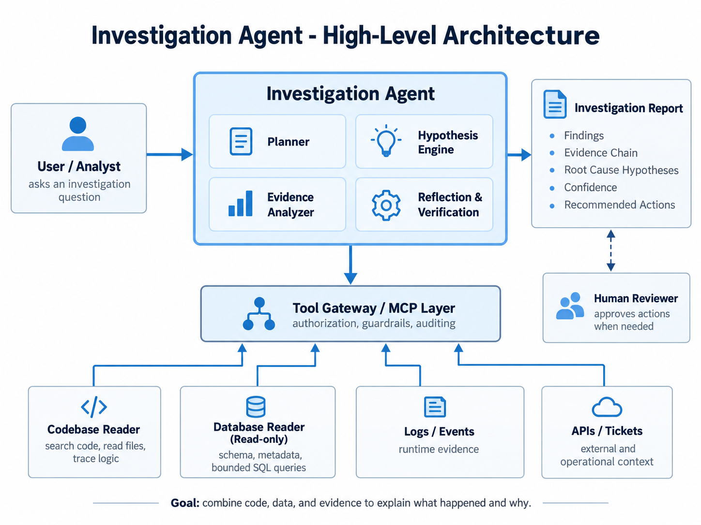

## 1. Investigation Agent

The central component coordinates the investigation and decides which evidence to collect next.

- **Planner:** Breaks the question into investigative steps and selects relevant tools.
- **Hypothesis Engine:** Proposes possible explanations based on available information.
- **Evidence Analyzer:** Examines retrieved evidence and connects observations across systems.
- **Reflection & Verification:** Checks hypotheses against evidence, identifies gaps, and decides whether further investigation is needed.

## 2. Tool Gateway / MCP Layer

A controlled interface between the agent and enterprise systems. It authenticates requests, enforces least-privilege access and query limits, and records tool usage for auditing. The agent cannot bypass these controls.

## 3. Evidence Sources and Tools

### Codebase Reader

Searches source code, reads authorized files, and traces business logic or call chains. It helps establish how the system is intended to behave. The deployed code version should be checked when analyzing production incidents.

### Database Reader (Read-only)

Explores permitted schemas and metadata, then executes bounded, read-only queries. It helps establish the actual state of accounts, relationships, and operational records without modifying data.

### Logs / Events

Retrieves application logs, execution events, and error records. It helps reconstruct what happened at runtime and identify failures not apparent from code or database state alone.

### APIs / Tickets

Retrieves approved context from external systems, such as CyberArk and ServiceNow. It can cross-check account status, workflow history, incidents, and change records.

## 4. Investigation Report

The agent presents a reviewable summary containing:

- **Findings:** The key observations and conclusions.
- **Evidence Chain:** Traceable sources and facts supporting each finding.
- **Root Cause Hypotheses:** Plausible explanations, distinguishing confirmed causes from unverified possibilities.
- **Confidence:** An assessment of evidence strength and remaining uncertainty.
- **Recommended Actions:** Suggested checks, remediation, or follow-up work.

## Investigation Flow

**Question → Plan → Gather evidence through the gateway → Analyze and verify → Report → Human review**

If the evidence is insufficient, the agent revises its plan and repeats the investigation. Its investigative approach can remain flexible while access permissions stay strictly controlled.
